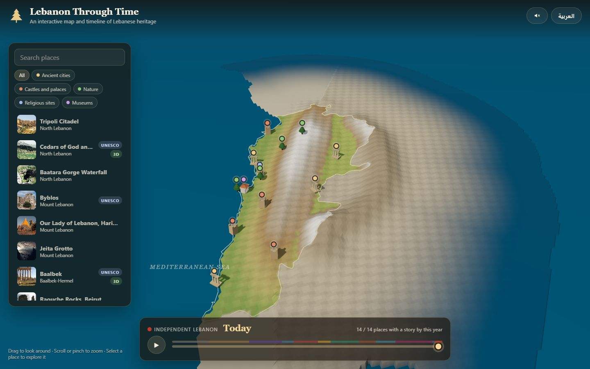
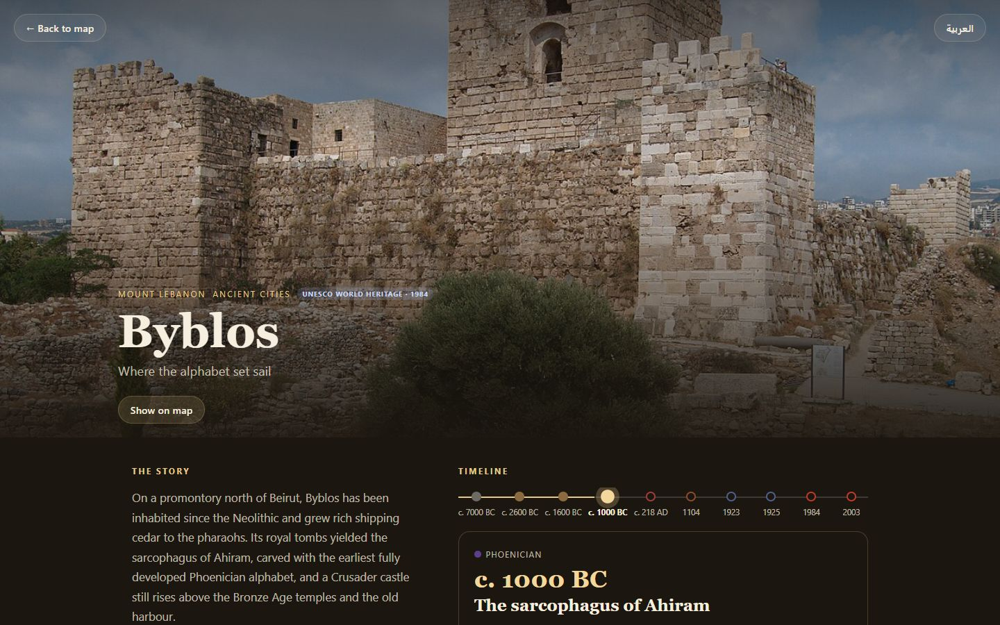
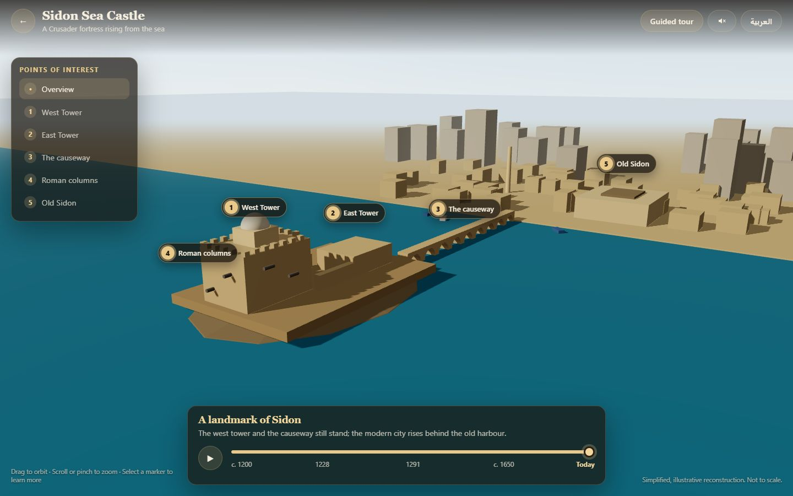

# Lebanon Through Time

**An interactive 3D map and timeline of Lebanon's heritage: zoom into a relief map, pick a place and travel through thousands of years of its history, in photographs, timelines and 3D reconstructions. English and Arabic.**

**Live:** https://lebanon-through-time.web.app

| The map | A site page | A 3D timeline |
| --- | --- | --- |
|  |  |  |

## What it does

- **A 3D relief map of Lebanon.** Mountains, the Bekaa valley and the coast are drawn in code from the Natural Earth outline. Fourteen places are pinned on it, filterable by category and searchable in both languages.
- **Travel through time on the map.** A slider sweeps 11,000 years of history, coloured by period (Phoenician, Roman, Crusader, Ottoman...). Pins light up as each place's story begins, and the selected place shows what was happening there in that year.
- **A page for every place** with its story, key facts, an interactive timeline of dated events (keyboard-friendly, with auto-play), a photo gallery with a lightbox, and nearby places.
- **Real photographs**, around sixty of them, from Wikimedia Commons, each credited on screen with its author and licence. Several are historical photographs from the 1860s to the 1950s.
- **Five 3D reconstructions you can scrub through time:**
  - **Baalbek**: the Temple of Jupiter rises, the Temple of Bacchus joins it, earthquakes bring the columns down until six are left.
  - **Sidon Sea Castle**: a Phoenician islet, the Crusader castle and its causeway, the Mamluk dismantling, Fakhr al-Din's restoration, the modern town.
  - **Anjar**: an Umayyad city laid out on the plain, abandoned after one generation, buried, then excavated and partly re-erected.
  - **Tyre**: Alexander's mole creeps across the strait, silts into an isthmus, Roman Tyre rises on the mainland, decays, and the modern peninsula appears.
  - **The Cedars of God**: a forest covering the mountainside shrinks over five millennia to a single walled grove, then is replanted.
- **English and Arabic** with a full right-to-left layout, remembered between visits. Every page has its own URL, so places and 3D views can be linked directly.
- **Responsive and accessible**: works with mouse, touch and keyboard; every 3D marker has a list equivalent; reduced-motion preferences are respected.

## Technical highlights

- **React Three Fiber + drei** on top of Three.js, strict **TypeScript**, built with **Vite**.
- **Procedural relief map.** The land mask comes from a simplified Natural Earth polygon (187 points for Lebanon); the elevation is a hand-shaped model of the two mountain ranges and the valley between them, so the whole map is a few kilobytes of code rather than a tile service or a height-map download.
- **Pure, tested timeline logic.** Every 3D scene has a framework-free layout module (what is built, falling or re-erected at time *t*) with its own unit tests, and the scenes only render that state. The map's non-linear time scale, the year formatting and the site data are unit tested too (109 tests with Vitest).
- **Instanced rendering.** Colonnades and forests are drawn with a handful of `InstancedMesh`es: Anjar's 350 columns, or the Cedars' 3,200 trees, cost four draw calls each. Instance matrices are recomputed only when the timeline moves.
- **Code splitting.** Each 3D experience is a lazily loaded chunk of about 5 KB gzipped; the map and site pages never pay for scenes you do not open.
- **A content pipeline.** `scripts/commons.mjs` searches Wikimedia Commons, checks that a photo's licence allows reuse, downloads a 1280 px and a 480 px copy and prints the credit block for the site file. Nothing is hand-copied.
- **No state library.** A 60-line observable store on `useSyncExternalStore`, with a tiny history-API router.
- **End-to-end tests** with Playwright (map, site page, 3D scene, Arabic layout) and **CI** with GitHub Actions: type check, unit tests and production build on every push.

## Project structure

```
src/
  data/
    sites/               One file per place (+ one for its photos); index.ts registers them
    lebanon/             Country outline (generated) and the relief model (pure, tested)
    types.ts, ui.ts, years.ts, regions.ts
  map/                   Relief map view: terrain, pins, camera, overlay, time slider
  site/                  Site page: hero, timeline, gallery
  experiences/
    shared/              Camera rig, markers, column fields, trees, atmosphere
    baalbek/ sidon/ anjar/ tyre/ cedars/   One folder per 3D scene (layout + tests, content, Scene)
    types.ts             Experience registry (lazy loaders)
  ui/                    Top bar, language toggle, info panel, timeline controls
  state/store.ts         Minimal app store
  lib/                   Router, playback hooks, seeded PRNG
scripts/
  commons.mjs            Wikimedia Commons photo helper
  extract-outline.mjs    Natural Earth -> src/data/lebanon/outline.ts
e2e/                     Playwright tests
```

## Run locally

Requires Node.js 20 or newer.

```bash
npm install
npm run dev        # http://localhost:5173
npm test           # unit tests
npm run test:e2e   # end-to-end tests (uses the installed Chrome)
npm run build      # production build in dist/
```

## Narration

The speaker button reads timelines aloud and turns the map's "play" into a guided tour. By default it uses the browser's own voices, which is free and offline but depends on the device: Windows and most phones ship English voices, while Arabic needs a language pack (Windows: Settings > Time & language > Speech). When no voice exists, the app says so and keeps the timing silently.

For consistent, high-quality narration in both languages, record the clips once with Azure Speech (it has Lebanese Arabic neural voices; the free tier covers the whole set):

```bash
npm install
AZURE_SPEECH_KEY=... AZURE_SPEECH_REGION=westeurope npm run narration
npm run narration -- --dry      # just count the clips and characters
```

This writes `public/audio/<lang>/<key>.mp3` and a manifest; the app plays a clip whenever one exists and only falls back to the browser voice otherwise. Re-run it after editing texts (only missing clips are recorded; add `--force` to redo all).

## Adding a place

1. Create `src/data/sites/<id>.ts` exporting a `Site` (see `baalbek.ts`) and `src/data/sites/<id>.photos.ts`.
2. Find and download photos: `node scripts/commons.mjs search "Place name" 12 --preview tmp/` then `node scripts/commons.mjs fetch "File:Name.jpg" <id> <slug>`; paste the printed block into the photos file and write captions in both languages.
3. Register the site in `src/data/sites/index.ts`. The unit tests check that every place is bilingual, sorted, credited and inside Lebanon.

To give a place a 3D scene, add a folder under `src/experiences/` with a pure `layout.ts`, a `Scene.tsx` and an `experience.ts`, then register it in `src/experiences/types.ts`.

## Deploy to Firebase Hosting (free)

```bash
npm install -g firebase-tools
firebase login
firebase use --add          # choose or create a Firebase project
npm run build
firebase deploy --only hosting
```

Hosting is included in Firebase's free Spark plan; this project needs no Cloud Functions or database.

## Accuracy and credits

The 3D scenes are **simplified, illustrative reconstructions**, not archaeological surveys: proportions and distances are compressed and some placements are approximate. Dates follow commonly cited estimates and are marked "c." where sources disagree. Photographs come from Wikimedia Commons under the licences shown with each image; the country outline is from Natural Earth (public domain).

## License

MIT. See [LICENSE](LICENSE).
