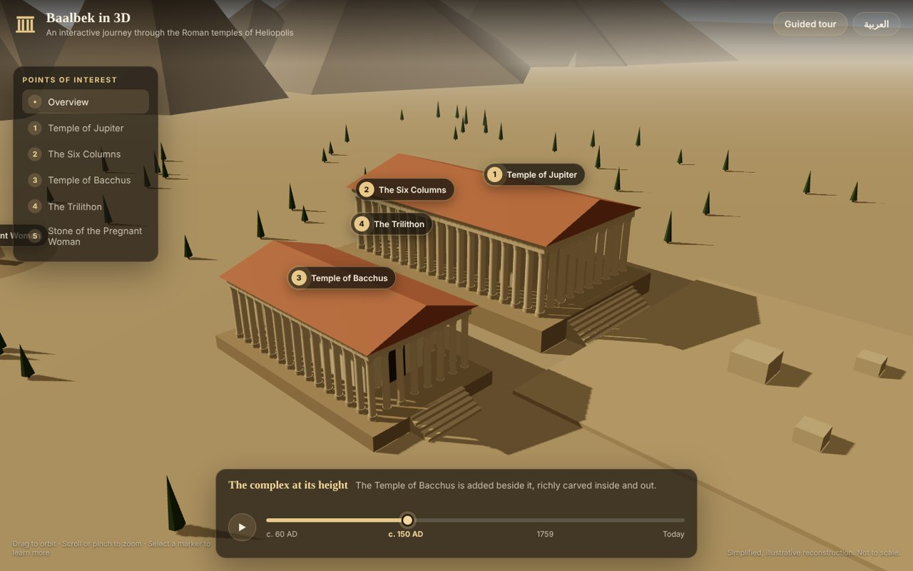
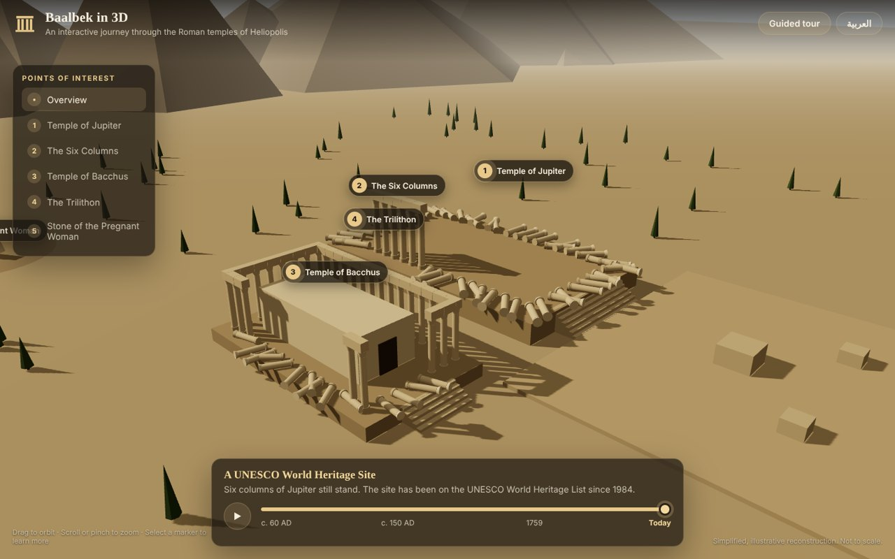
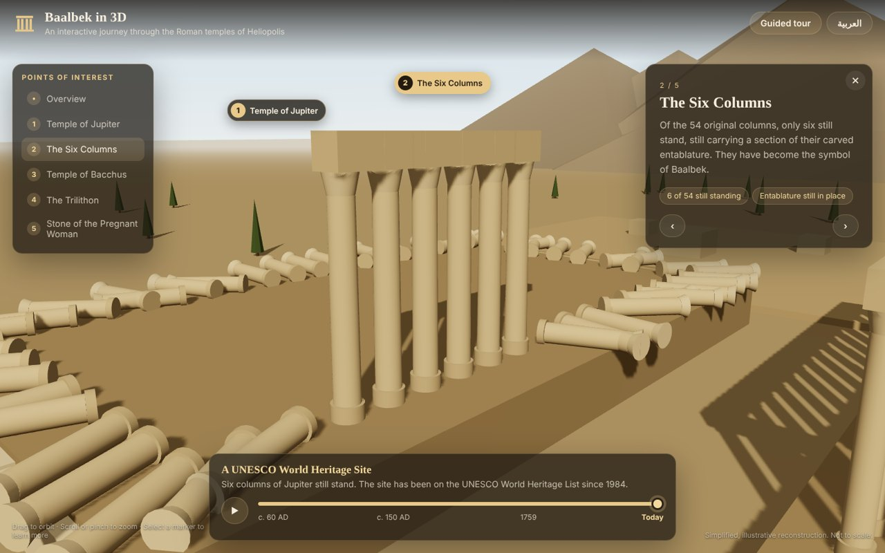
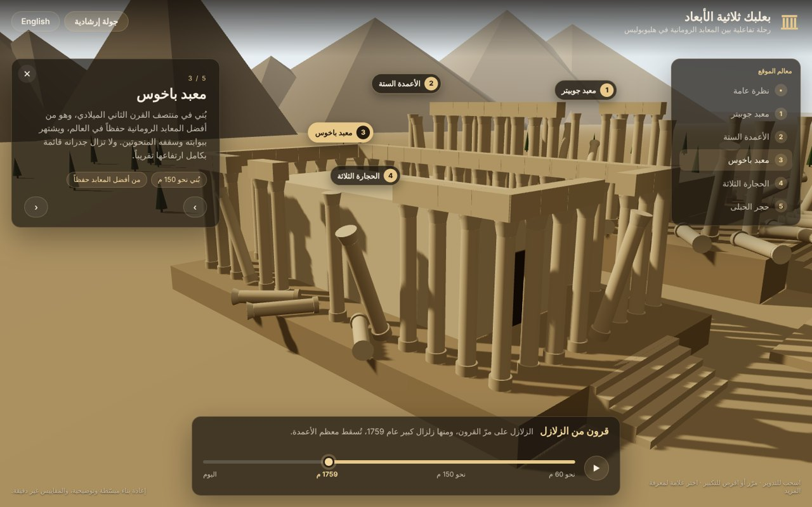

# Baalbek in 3D

**An interactive 3D journey through the Roman temples of Baalbek (ancient Heliopolis), from their construction to the ruins of today.**

**Live demo:** https://baalbek-3d.web.app



Drag a timeline slider and watch nearly 2,000 years unfold: the Temple of Bacchus rises beside the Temple of Jupiter, roofs collapse, earthquakes topple the colonnades, and only the famous six columns are left standing. Select a landmark and the camera flies to it, with the story told in English or Arabic.

| Today | The Six Columns | Arabic (right-to-left) |
| --- | --- | --- |
|  |  |  |

## Features

- **Time travel.** A timeline from c. 60 AD to today, with four key eras. Columns are built and fall with eased, staggered animations, and the entablature only spans columns that are still standing.
- **Guided exploration.** Five points of interest (Temple of Jupiter, the Six Columns, Temple of Bacchus, the Trilithon, the Stone of the Pregnant Woman). Selecting one flies the camera there smoothly; dragging during a flight hands control straight back to you.
- **Guided tour and "play history"** modes for a hands-off walkthrough.
- **English and Arabic**, including a full right-to-left layout, remembered between visits.
- **Responsive.** Works with mouse, trackpad and touch, from phones to large screens.
- **Accessible.** Every 3D marker has a keyboard-reachable equivalent in the side list; reduced-motion preferences are respected.

## Technical highlights

- **React Three Fiber + drei** on top of Three.js, written in strict **TypeScript**.
- **Instanced rendering.** All 96 columns and their entablature segments are drawn with four `InstancedMesh`es instead of hundreds of meshes. Instance matrices are recomputed only when the timeline changes.
- **Pure, tested scene logic.** Column layout, survival rules and the build/fall timeline live in a framework-free module (`src/data/templeLayout.ts`) with a seeded PRNG, so the scene is deterministic and covered by unit tests (Vitest).
- **Procedural geometry.** Every object is generated in code, so there are no 3D model downloads and the whole app loads in a few hundred kilobytes (gzipped).
- **No state library.** A ~40-line observable store built on React's `useSyncExternalStore`.
- **CI** with GitHub Actions: type check, tests and production build on every push.
- **Free hosting** on Firebase Hosting, with long-term caching for hashed assets.

## Project structure

```
src/
  data/
    templeLayout.ts      Column layout and timeline logic (pure, unit tested)
    content.ts           Points of interest, eras and UI text (English + Arabic)
  scene/
    Scene.tsx            Canvas setup
    Columns.tsx          Instanced columns and entablature
    Temples.tsx          Podiums, sanctuaries, roofs, Trilithon, quarry stone
    Environment.tsx      Sky, light, ground, mountains, trees
    CameraRig.tsx        Orbit controls and fly-to transitions
    Hotspots.tsx         Clickable markers in the 3D scene
  ui/                    Top bar, places list, info panel, timeline, intro
  state/store.ts         Minimal app store
  lib/                   Translation hook, timeline playback and guided tour
```

## Run locally

Requires Node.js 20 or newer.

```bash
npm install
npm run dev      # http://localhost:5173
npm test         # unit tests
npm run build    # production build in dist/
```

## Deploy to Firebase Hosting (free)

```bash
npm install -g firebase-tools
firebase login
firebase use --add          # choose or create a Firebase project
npm run build
firebase deploy --only hosting
```

Hosting is included in Firebase's free Spark plan; this project needs no Cloud Functions or database.

## About the reconstruction

This is a **simplified, illustrative model**, not an archaeological survey. Proportions, distances and the placement of fallen columns are approximate, and the quarry is shown much closer than it really is. Historical figures in the app (column counts, approximate dates and stone weights) follow commonly cited estimates.

## License

MIT © Mohammad Bilal Sehwail
